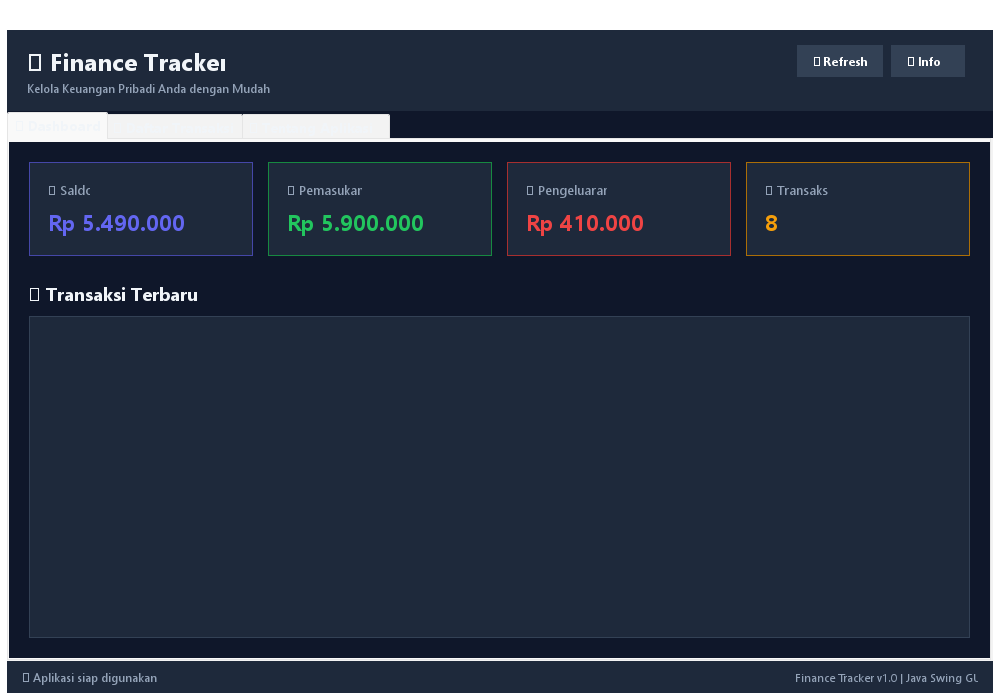
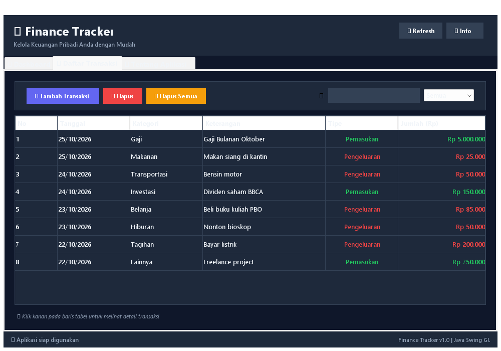
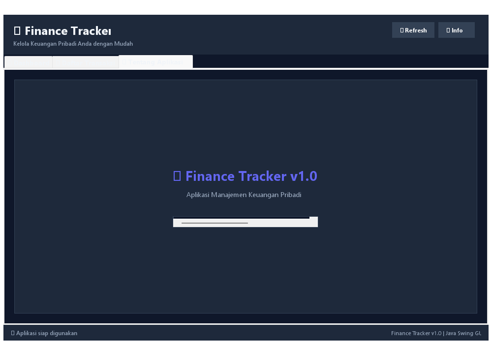

# 💰 Finance Tracker - Aplikasi Manajemen Keuangan Pribadi

Aplikasi GUI berbasis **Java Swing** untuk mengelola keuangan pribadi. Dibuat sebagai tugas **Latihan Materi GUI** mata kuliah Pemrograman Berorientasi Objek (PBO).

---

## 📸 Screenshot Aplikasi

> *Tambahkan screenshot aplikasi di sini*

### Dashboard


### Form Tambah Transaksi


### Detail Transaksi


### Tab Daftar Transaksi


### Tab Tentang Aplikasi


---

## 🚀 Cara Menjalankan

```bash
# Compile
javac -encoding UTF-8 src/FinanceTrackerApp.java -d out

# Jalankan
java -cp out FinanceTrackerApp
```

---

## 🏗️ Komponen GUI yang Digunakan

### 1. Top Level Container

Top Level Container adalah container utama yang menjadi wadah tertinggi dari seluruh komponen GUI. Setiap aplikasi Swing harus memiliki minimal satu Top Level Container.

| Komponen | Penggunaan dalam Aplikasi |
|----------|--------------------------|
| **JFrame** | Window utama aplikasi Finance Tracker. Menjadi container induk yang menampung semua panel, tabel, dan komponen lainnya. |
| **JDialog** | Digunakan untuk **dialog tambah transaksi baru** (modal dialog) dan **dialog detail transaksi** saat user klik kanan/double-click pada tabel. |

#### Kode JFrame:
```java
public class FinanceTrackerApp extends JFrame implements ActionListener, MouseListener, ItemListener, KeyListener {
    public FinanceTrackerApp() {
        setTitle("💰 Finance Tracker - Manajemen Keuangan Pribadi");
        setSize(1000, 700);
        setDefaultCloseOperation(JFrame.EXIT_ON_CLOSE);
        setLocationRelativeTo(null);
    }
}
```

#### Kode JDialog:
```java
private void showAddTransactionDialog() {
    JDialog dialog = new JDialog(this, "➕ Tambah Transaksi Baru", true);
    dialog.setSize(450, 420);
    dialog.setLocationRelativeTo(this);
    // ... form transaksi
    dialog.setVisible(true);
}
```

---

### 2. Intermediate Component

Intermediate Component adalah container perantara yang digunakan untuk mengelompokkan dan mengatur tata letak komponen-komponen atomic.

| Komponen | Penggunaan dalam Aplikasi |
|----------|--------------------------|
| **JPanel** | Digunakan secara ekstensif untuk mengelompokkan komponen: header panel, dashboard cards, toolbar, form panel, dll. |
| **JScrollPane** | Membungkus JTable agar tabel dapat di-scroll ketika data transaksi melebihi area tampilan. Juga digunakan pada halaman About. |
| **JTabbedPane** | Navigasi utama aplikasi dengan 3 tab: Dashboard, Daftar Transaksi, dan Tentang Aplikasi. |

#### Kode JTabbedPane:
```java
tabbedPane = new JTabbedPane();
tabbedPane.addTab("📊 Dashboard", dashboardPanel);
tabbedPane.addTab("📋 Daftar Transaksi", transactionPanel);
tabbedPane.addTab("ℹ️ Tentang Aplikasi", aboutPanel);
```

#### Kode JScrollPane:
```java
tableScrollPane = new JScrollPane(transactionTable);
tableScrollPane.getViewport().setBackground(CARD_BG);
```

---

### 3. Atomic Component

Atomic Component adalah komponen terkecil yang tidak bisa memuat komponen lain. Komponen ini berinteraksi langsung dengan pengguna.

| Komponen | Penggunaan dalam Aplikasi |
|----------|--------------------------|
| **JButton** | Tombol aksi: Tambah Transaksi, Hapus, Hapus Semua, Refresh, Info, Simpan, Batal, Tutup |
| **JLabel** | Label teks untuk judul, subtitle, label form, nilai saldo/pemasukan/pengeluaran, status bar |
| **JTextField** | Input teks untuk tanggal, keterangan, jumlah uang, dan field pencarian |
| **JComboBox** | Dropdown untuk memilih kategori transaksi (Makanan, Transportasi, dll) dan filter tipe (Semua, Pemasukan, Pengeluaran) |
| **JRadioButton** | Pilihan tipe transaksi: Pemasukan atau Pengeluaran (dengan ButtonGroup) |
| **JTable** | Menampilkan data transaksi dalam format tabel dengan kolom: No, Tanggal, Kategori, Keterangan, Tipe, Jumlah |
| **JTextArea** | Menampilkan informasi komponen GUI pada halaman About |

#### Kode JRadioButton:
```java
JRadioButton rbIncome = new JRadioButton("Pemasukan");
JRadioButton rbExpense = new JRadioButton("Pengeluaran");
ButtonGroup typeGroup = new ButtonGroup();
typeGroup.add(rbIncome);
typeGroup.add(rbExpense);
```

#### Kode JTable:
```java
String[] columns = {"No", "Tanggal", "Kategori", "Keterangan", "Tipe", "Jumlah (Rp)"};
tableModel = new DefaultTableModel(columns, 0);
transactionTable = new JTable(tableModel);
```

#### Kode JComboBox:
```java
String[] filterOptions = {"Semua", "Pemasukan", "Pengeluaran"};
cmbFilter = new JComboBox<>(filterOptions);
cmbFilter.addItemListener(this);
```

---

### 4. Layout Manager

Layout Manager mengatur posisi dan ukuran komponen dalam container secara otomatis.

| Layout Manager | Penggunaan dalam Aplikasi |
|----------------|--------------------------|
| **BorderLayout** | Layout utama JFrame (NORTH=header, CENTER=tabbedPane, SOUTH=statusBar). Juga digunakan di panel dashboard dan transaksi. |
| **GridBagLayout** | Layout form pada dialog tambah transaksi dan halaman About. Memberikan kontrol presisi atas posisi komponen. |
| **FlowLayout** | Layout tombol-tombol aksi (Tambah, Hapus, Hapus Semua) dan panel pencarian. Komponen dijajarkan secara horizontal. |
| **BoxLayout** | Layout vertikal untuk judul header (judul + subtitle) dan kartu summary dashboard (judul kartu + nilai). |
| **GridLayout** | Layout 4 kartu ringkasan dashboard (Saldo, Pemasukan, Pengeluaran, Jumlah Transaksi) dengan ukuran sama rata. |

#### Kode BorderLayout:
```java
setLayout(new BorderLayout());
add(headerPanel, BorderLayout.NORTH);
add(tabbedPane, BorderLayout.CENTER);
add(statusBar, BorderLayout.SOUTH);
```

#### Kode GridBagLayout:
```java
JPanel formPanel = new JPanel(new GridBagLayout());
GridBagConstraints gbc = new GridBagConstraints();
gbc.fill = GridBagConstraints.HORIZONTAL;
gbc.insets = new Insets(8, 5, 8, 5);
gbc.gridx = 0; gbc.gridy = 1;
formPanel.add(lblDate, gbc);
```

#### Kode GridLayout:
```java
JPanel cardsPanel = new JPanel(new GridLayout(1, 4, 15, 0));
cardsPanel.add(balanceCard);
cardsPanel.add(incomeCard);
cardsPanel.add(expenseCard);
cardsPanel.add(countCard);
```

---

### 5. Event Handling

Event Handling memungkinkan aplikasi merespons aksi/interaksi dari pengguna. Aplikasi ini mengimplementasikan **4 interface** event handling.

#### Interface 1: ActionListener
Menangani event klik tombol.

```java
public class FinanceTrackerApp extends JFrame implements ActionListener, ... {

    @Override
    public void actionPerformed(ActionEvent e) {
        Object source = e.getSource();
        if (source == btnAddTransaction) {
            showAddTransactionDialog();
        } else if (source == btnDeleteTransaction) {
            // hapus transaksi terpilih
        } else if (source == btnClearAll) {
            // hapus semua transaksi
        } else if (source == btnRefresh) {
            updateDashboard();
        }
    }
}
```

**Digunakan pada:** Tombol Tambah, Hapus, Hapus Semua, Refresh, Info, Simpan, Batal, Tutup.

#### Interface 2: MouseListener
Menangani event klik dan hover mouse.

```java
@Override
public void mouseClicked(MouseEvent e) {
    if (e.getSource() == transactionTable) {
        // Klik kanan untuk detail transaksi
        if (SwingUtilities.isRightMouseButton(e)) {
            int row = transactionTable.rowAtPoint(e.getPoint());
            showTransactionDetail(row);
        }
        // Double click juga untuk detail
        if (e.getClickCount() == 2) {
            showTransactionDetail(transactionTable.getSelectedRow());
        }
    }
}

@Override
public void mouseEntered(MouseEvent e) {
    // Efek hover pada kartu summary dashboard
}

@Override
public void mouseExited(MouseEvent e) {
    // Reset efek hover
}
```

**Digunakan pada:** Tabel transaksi (klik kanan & double-click) dan kartu dashboard (hover effect).

#### Interface 3: ItemListener
Menangani perubahan pilihan pada JComboBox.

```java
@Override
public void itemStateChanged(ItemEvent e) {
    if (e.getSource() == cmbFilter && e.getStateChange() == ItemEvent.SELECTED) {
        refreshTable(); // Filter tabel berdasarkan tipe yang dipilih
    }
}
```

**Digunakan pada:** ComboBox filter tipe transaksi (Semua / Pemasukan / Pengeluaran).

#### Interface 4: KeyListener
Menangani event keyboard untuk fitur pencarian real-time.

```java
@Override
public void keyReleased(KeyEvent e) {
    if (e.getSource() == txtSearch) {
        refreshTable(); // Filter tabel berdasarkan kata kunci
    }
}
```

**Digunakan pada:** TextField pencarian — tabel langsung ter-filter saat user mengetik.

---

## 🎨 Fitur Aplikasi

- ✅ **Dashboard** dengan ringkasan saldo, pemasukan, pengeluaran, dan jumlah transaksi
- ✅ **Tambah transaksi** melalui dialog form (pemasukan/pengeluaran)
- ✅ **Hapus transaksi** (satu/semua)
- ✅ **Pencarian real-time** berdasarkan kata kunci
- ✅ **Filter** berdasarkan tipe transaksi
- ✅ **Detail transaksi** dengan klik kanan atau double-click
- ✅ **Hover effect** pada kartu dashboard dan tombol
- ✅ **Dark theme** modern
- ✅ **Format mata uang Rupiah** otomatis

---

## 🛠️ Teknologi

- **Bahasa:** Java
- **GUI Framework:** Java Swing
- **JDK:** 8+

---

## 📁 Struktur Proyek

```
FinanceTracker/
├── src/
│   └── FinanceTrackerApp.java    # Source code utama
├── out/                           # Hasil kompilasi (.class)
├── screenshots/                   # Screenshot aplikasi
│   ├── dashboard.png
│   ├── tambah_transaksi.png
│   ├── detail_transaksi.png
│   ├── daftar_transaksi.png
│   └── tentang_aplikasi.png
└── README.md                      # Dokumentasi ini
```
